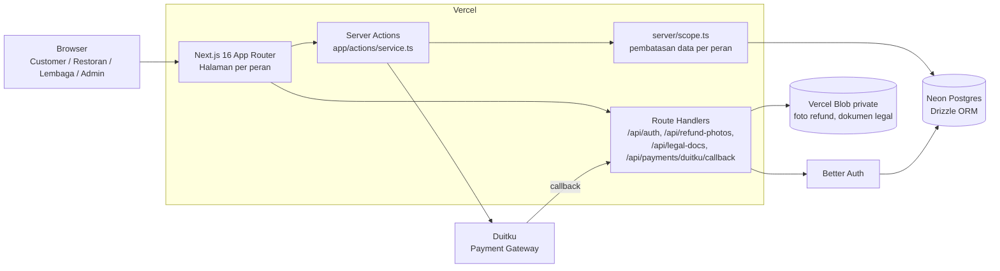
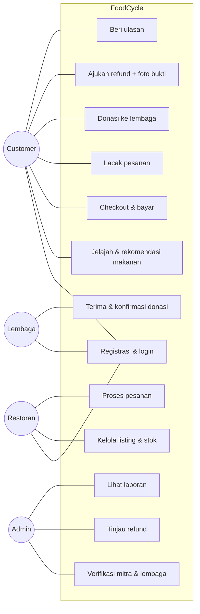
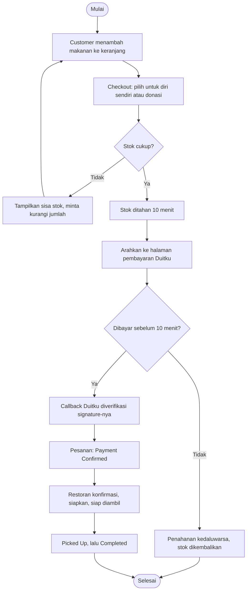
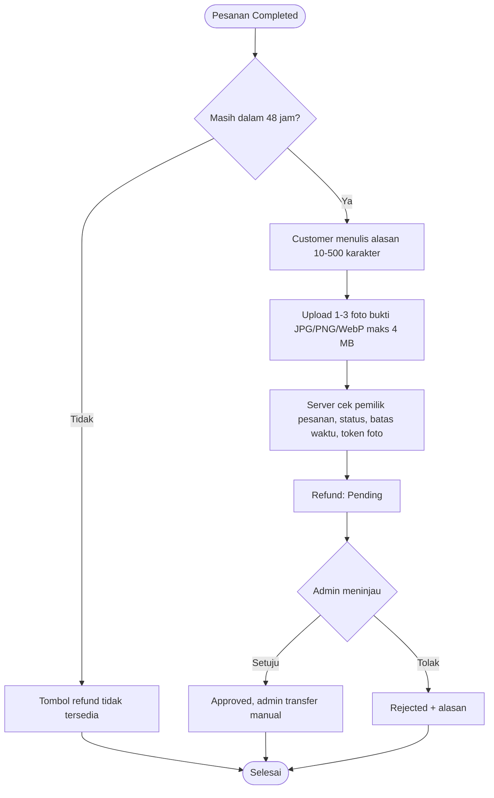
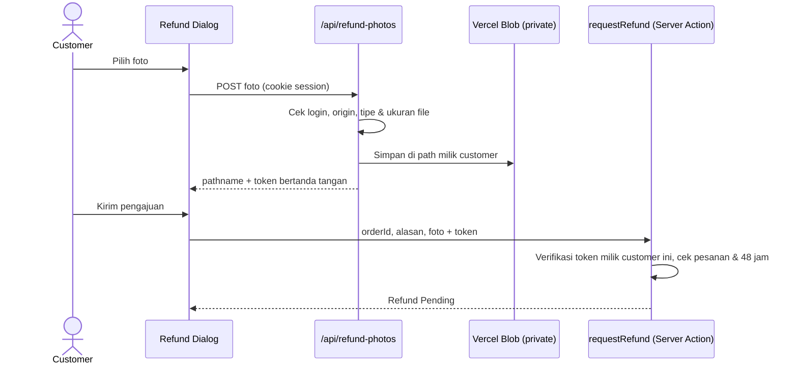
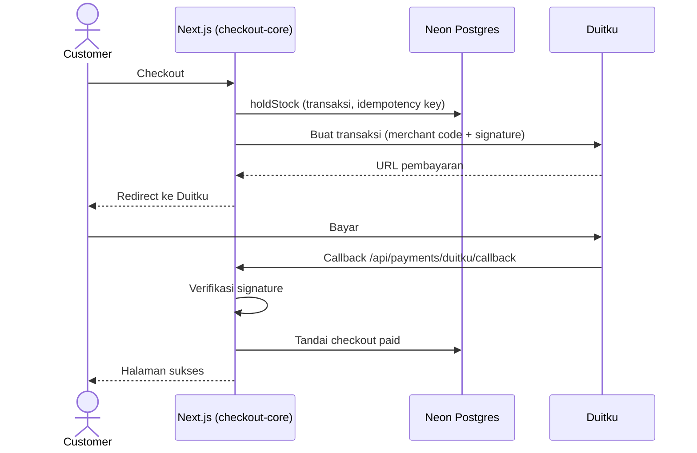
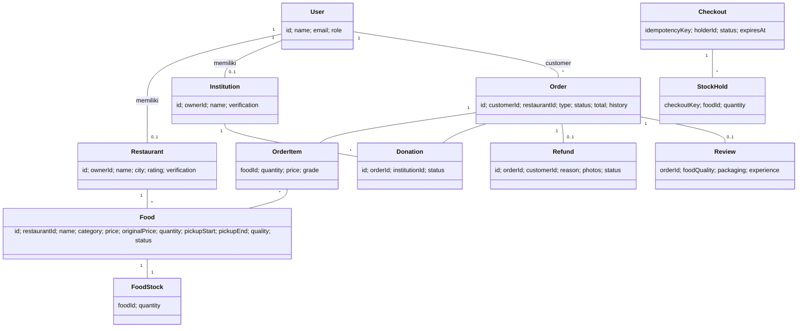

# Desain Sistem FoodCycle

Diagram ditulis dalam Mermaid sehingga tampil langsung di GitHub. Untuk laporan, buka di [mermaid.live](https://mermaid.live) lalu ekspor ke PNG.

## 1. Arsitektur

## 2. Use Case

## 3. Activity Diagram: Checkout & Pembayaran

## 4. Activity Diagram: Refund

## 5. Sequence Diagram: Upload Foto Bukti Refund

## 6. Sequence Diagram: Pembayaran Duitku

## 7. Class Diagram (Model Data Utama)

Tabel Postgres saat ini (`lib/db/schema.ts`): `food_stock`, `checkouts`, `stock_holds`, serta tabel Better Auth. Entitas lain masih dilayani oleh lapisan layanan dengan data contoh (`services/mock-db.ts`). Memindahkannya ke Postgres tercatat sebagai risiko R07.
